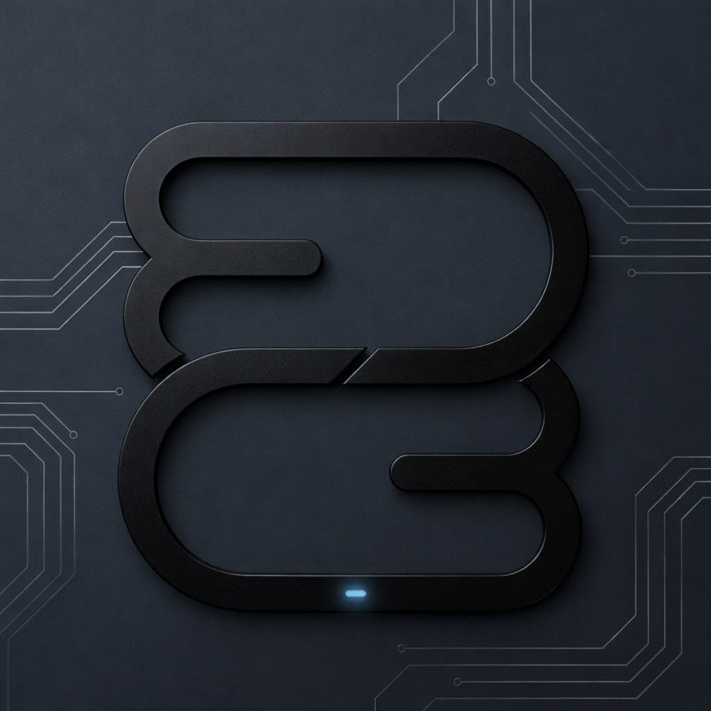

# 1 Year of Edge Robotics Studio

It has been an incredible journey since launching Edge Robotics Studio one year ago. From the very beginning, the goal has been to explore the boundaries of robotics, embedded systems, and automation software.

## A Year of Growth and Learning

Reflecting on the past year, the studio has faced exciting technical hurdles, built complex systems, and grown alongside a passionate community. This milestone marks not just the passage of time, but the solid foundation laid for future innovations.

A sincere thank you to everyone who has supported this journey and believed in the vision. The future is bright, and this is just the beginning!
